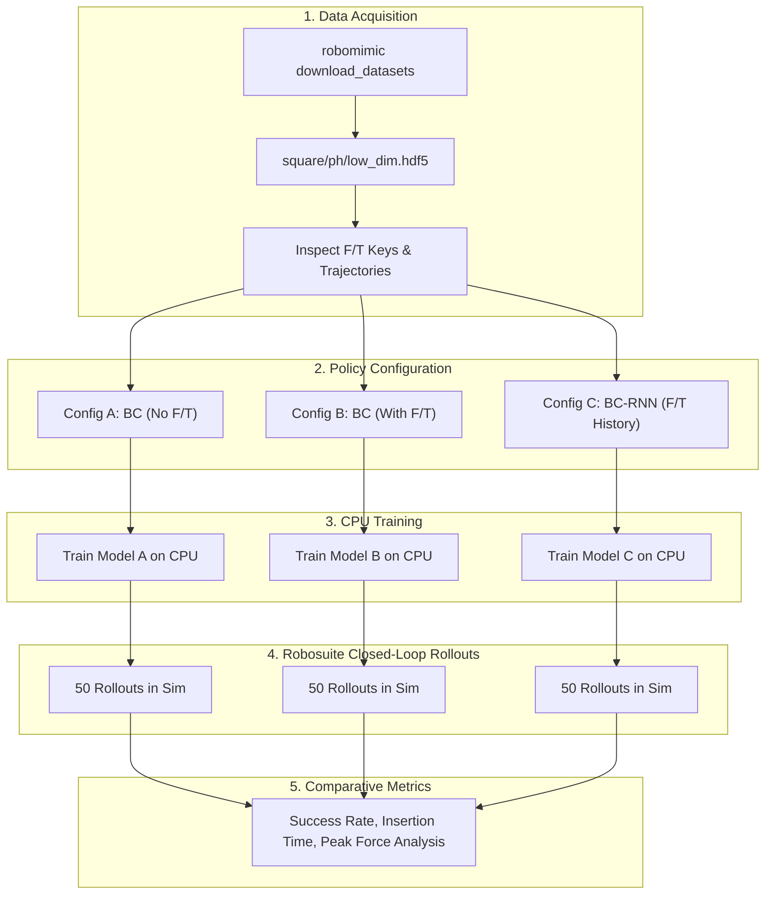

# Implementation Plan: Contact-Rich Manipulation with Robosuite & Robomimic

**Project Objective**: Benchmark Behavioral Cloning (BC) and Recurrent Behavioral Cloning (BC-RNN) on the contact-rich **Square** (Nut Assembly) task using pre-collected human demonstrations from `robomimic`, comparing policy performance **with and without end-effector force/torque (F/T) history**. All data processing, training, and evaluation are structured to run efficiently on CPU.

---

## 1. Experimental Design & Hypothesis

### The Scientific Question
In tight-tolerance peg-in-hole and nut-assembly tasks, visual or Cartesian position drift causes "wedging" and "jamming" when inserting rigid parts. 
* Can an imitation policy utilize wrist force/torque sensor readings to detect contact transients and compliant alignment?
* Does recurrent history (BC-RNN) over force trajectories outperform instantaneous force snapshots (BC-MLP) and proprioception-only policies?

### Experimental Conditions (Ablation Matrix)

| Condition | Architecture | Input Observations | Recurrence / History | Core Hypothesis |
| :--- | :--- | :--- | :---: | :--- |
| **Model A (Baseline)** | Standard BC (MLP) | EE Pos + Quat + Gripper + Object | None (1 step) | Position-only baseline; vulnerable to contact jamming. |
| **Model B (Instant F/T)**| Standard BC (MLP) | EE Pos + Quat + Gripper + Object + **F/T** | None (1 step) | Reacts to instant force thresholds, but lacks temporal velocity/transient context. |
| **Model C (F/T History)**| **BC-RNN (LSTM/GRU)**| EE Pos + Quat + Gripper + Object + **F/T** | Sequence ($H=10$) | Uses force history ($dF/dt$) to guide smooth insertion and avoid jamming. |

---

## 2. System Architecture & Workflow



---

## 3. Step-by-Step Execution Plan

### Phase 1: Environment Setup & Sanity Check
* **Step 1.1**: Set up a local Python virtual environment (recommended Python 3.9 - 3.10).
* **Step 1.2**: Install core dependencies:
  * `mujoco` ($\ge 2.3.0$)
  * `robosuite`
  * `robomimic`
  * `torch` (CPU wheel), `h5py`, `matplotlib`, `seaborn`, `pandas`
* **Step 1.3**: Run a lightweight environment sanity script: instantiate `NutAssemblySquare` with `Panda` arm and verify step/reset and sensor readings (`robot0_eef_force`, `robot0_eef_torque`).

### Phase 2: Dataset Acquisition & Validation
* **Step 2.1**: Download the canonical low-dimensional proficient-human demonstration dataset for the `Square` task:
  ```bash
  python -m robomimic.scripts.download_datasets --tasks square --dataset_types ph --hdf5_types low_dim
  ```
  *(Size: ~15 MB, 200 demonstrations).*
* **Step 2.2**: Execute an inspection script to verify:
  * Trajectory count, step lengths, and success flags.
  * Observation keys: `robot0_eef_pos` (3), `robot0_eef_quat` (4), `robot0_gripper_qpos` (2), `object` (14), `robot0_eef_force` (3), `robot0_eef_torque` (3).
  * Check value distributions and normalization statistics.

### Phase 3: Configuration Generation
Create clean, dedicated JSON configuration files using robomimic's config templates:
* **`config_bc_no_ft.json`**:
  * Modalities: `["robot0_eef_pos", "robot0_eef_quat", "robot0_gripper_qpos", "object"]`.
  * Policy: MLP (Gaussian / GMM action head or deterministic L2 regression).
* **`config_bc_with_ft.json`**:
  * Modalities: baseline + `["robot0_eef_force", "robot0_eef_torque"]`.
  * Policy: MLP.
* **`config_bc_rnn_with_ft.json`**:
  * Modalities: baseline + `["robot0_eef_force", "robot0_eef_torque"]`.
  * Policy: Recurrent (LSTM/GRU, sequence length $H=10$).

### Phase 4: CPU-Optimized Training Pipeline
* **Step 4.1**: Train Model A (No F/T): 50 epochs, batch size 64.
* **Step 4.2**: Train Model B (With Instant F/T): 50 epochs, batch size 64.
* **Step 4.3**: Train Model C (BC-RNN with F/T History): 50 epochs, batch size 64.
* **Step 4.4**: Track loss curves (training loss and validation loss across epochs) to confirm convergence without overfitting.
* *Note: Because inputs are low-dimensional vectors (dim ~ 26), 50 epochs on CPU completes in ~10–15 minutes per model.*

### Phase 5: Closed-Loop Simulation Evaluation
* **Step 5.1**: Run 50 evaluation rollouts per model in the robosuite `NutAssemblySquare` simulation environment using robomimic's rollout engine (`run_trained_agent.py` or a custom metric collector).
* **Step 5.2**: Log performance data at every timestep:
  * Insertion Success (Binary: 0 or 1).
  * Time to Insertion (Number of environment steps).
  * End-Effector Contact Force Profile ($\|F\|_2 = \sqrt{F_x^2 + F_y^2 + F_z^2}$).
  * Jamming / Wedging Instances (High sustained force with near-zero position delta).

### Phase 6: Result Analysis & Visualization
* **Step 6.1**: Compute comparative statistics:
  * **Success Rate (%)** across the 50 seeds.
  * **Mean & Median Time to Completion**.
  * **Mean Peak Contact Force** (N) during the insertion phase.
* **Step 6.2**: Generate visualization plots:
  * Bar plot of success rates with confidence intervals.
  * Force profile curves showing how the F/T-aware policy modulates force during contact vs the baseline.
* **Step 6.3**: Compile the final summary report with insights on contact-rich behavioral cloning.

---

## 4. Deliverables

1. **`scripts/inspect_dataset.py`**: Dataset verification & observation key inspector.
2. **`configs/*.json`**: Three reproducible robomimic experiment configurations.
3. **`scripts/train.py` & `scripts/evaluate.py`**: Automated training & evaluation runner scripts.
4. **`results/`**: Training logs, evaluation telemetry (forces, times, success rates), and comparison graphs.
5. **Final Evaluation Report**: Comprehensive breakdown of results and findings.
